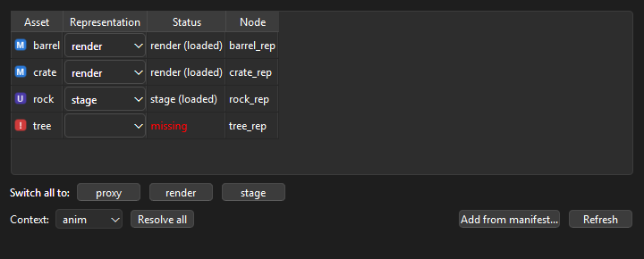
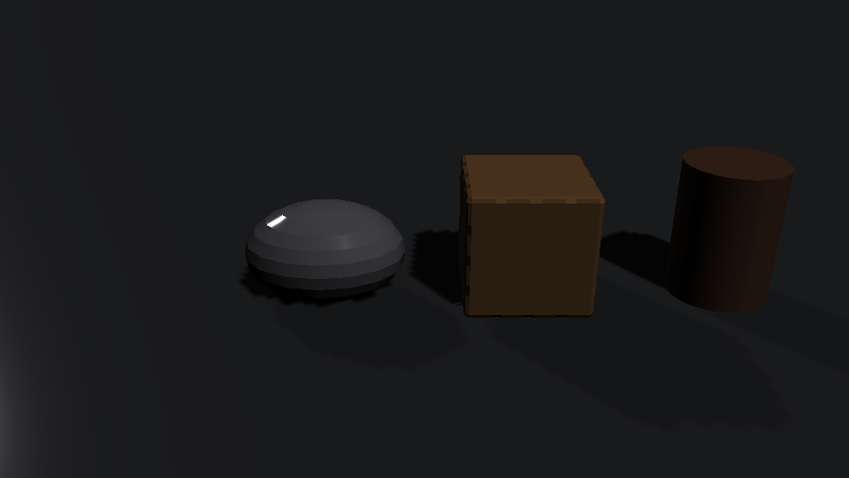

# rep_switch

A Maya plug-in for switching an asset between its proxy, anim cache, render model and USD stage.



I wrote this because big scenes can't carry everything at full resolution. Layout wants proxies and lighting wants the real models. The farm needs render versions even when someone saved the scene in proxy mode. Each asset gets one `repAsset` node, and you change what's loaded under it from a panel, the right-click menu, the Attribute Editor or a script.



## Install

Clone or download the repo and drag `install_rep_switch.py` into the Maya viewport. It loads the plug-in, sets it to load on startup and puts a RepSwitch button on your shelf. If Maya has no PyYAML, it gets pip-installed into the repo's `deps` folder, so the first run needs internet. Move the folder and you'll need to drag the file in again.

## Using it

Open the panel from the shelf button and use "Add from manifest..." to bring assets in. From there you can pick a representation per asset, or choose a context like farm and press "Resolve all". Every switch can be undone.

A manifest is JSON or YAML with paths relative to itself. This is `examples/crate.yaml`:

```yaml
asset: crate
default: proxy
representations:
  proxy:  {type: gpuCache, path: publish/crate_proxy.abc}
  anim:   {type: alembic,  path: publish/crate_anim.abc}
  render: publish/crate_render.ma
  stage:  publish/crate.usda
```

From a script:

```python
from maya import cmds
from rep_switch import manifest, maya_scene

for asset in manifest.read_manifest("D:/publish/crate/crate.yaml"):
    maya_scene.create_node(asset)

cmds.repSwitch(asset=["crate"], representation="render")
cmds.repSwitch(all=True, context="farm")
cmds.repSwitch(asset=["crate"], query=True)   # ["render"]
```

A context is an ordered list of preferences, falling back to the asset's default when nothing in it is on disk. You can supply your own by pointing `REP_SWITCH_RULES` at a file like `examples/rules.yaml`. With no representation or context given, `repSwitch` reads `REP_SWITCH_CONTEXT` and otherwise uses farm in batch and layout in the UI. That means a pre-render script can just call `cmds.repSwitch(all=True)`.

## Tests

```bash
pip install -e ".[test]"
pytest              # the parts that don't need Maya
mayapy -m pytest    # also loads the plug-in and switches through all four types
```

## Limits

Undoing a switch away from a Maya file reloads the reference, so reference edits from that session are lost. The node ids come from Autodesk's local range, so get your own block before sharing scenes outside one studio.
